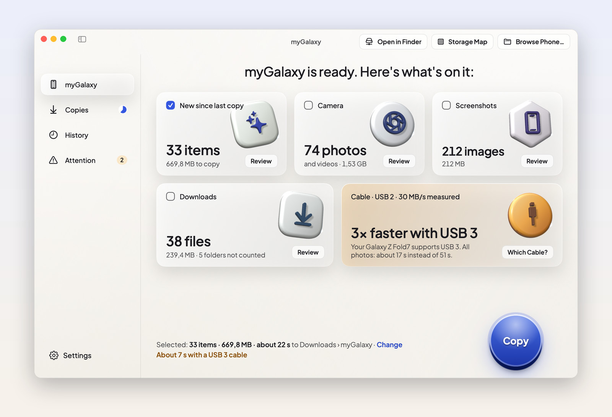
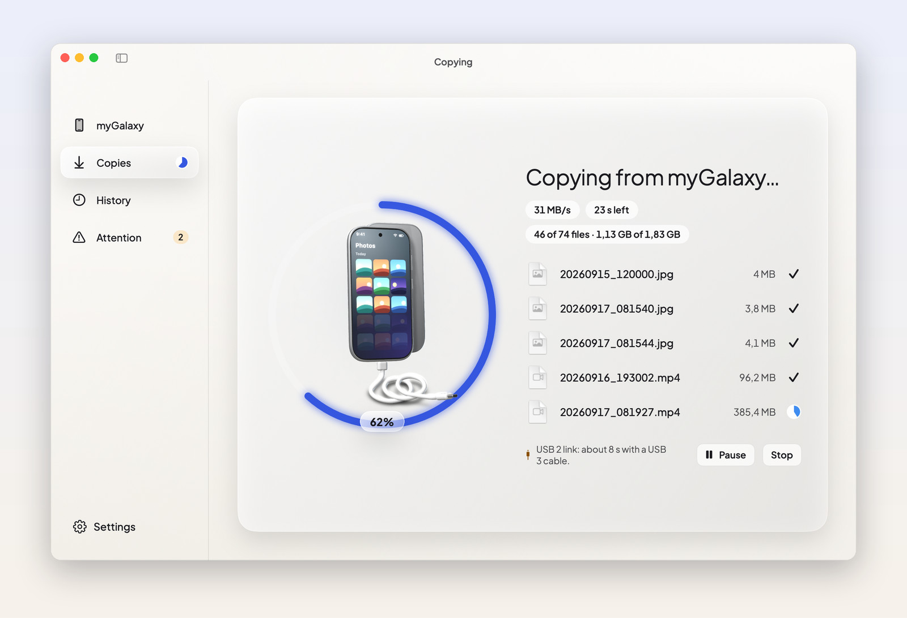
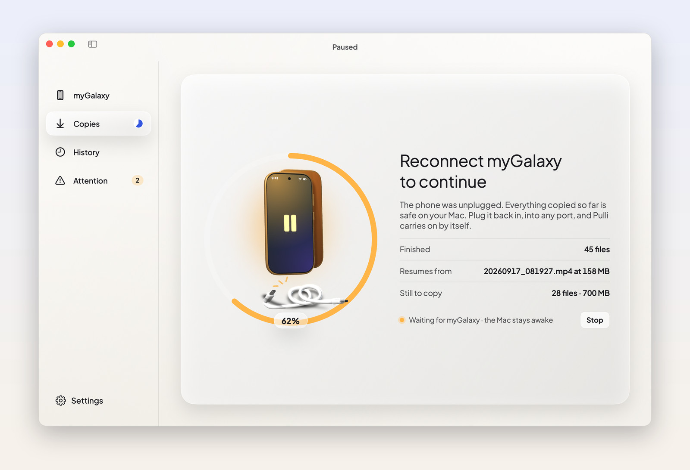
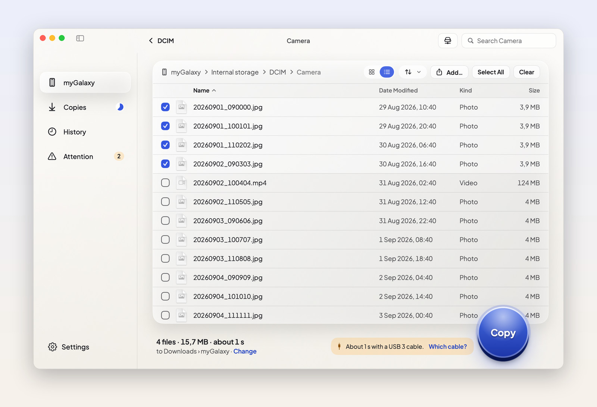
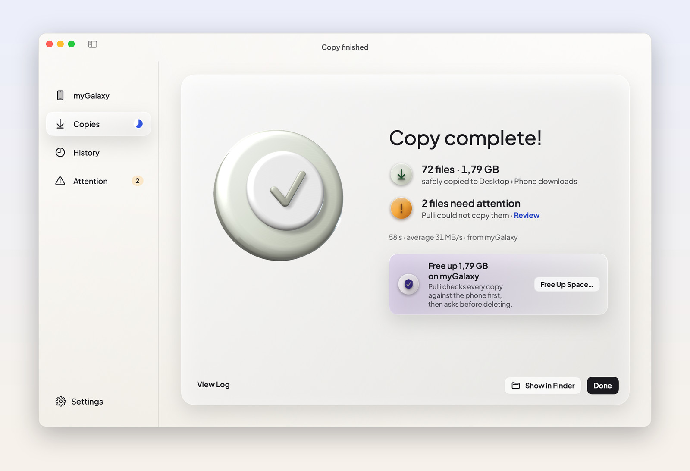
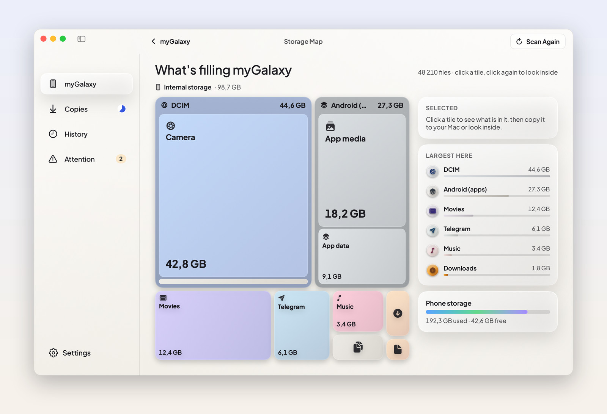
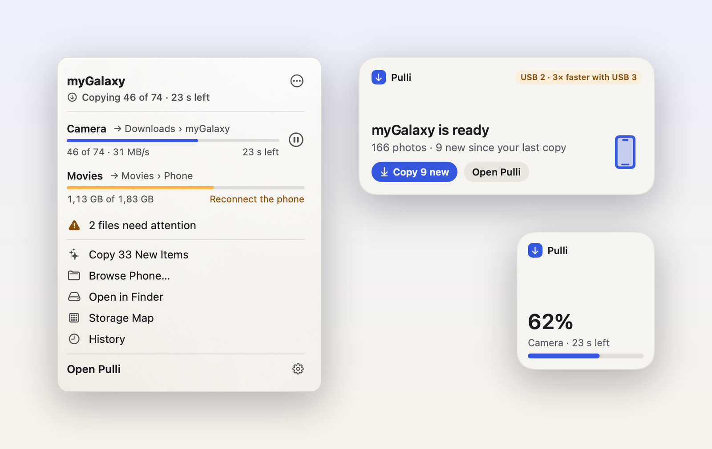
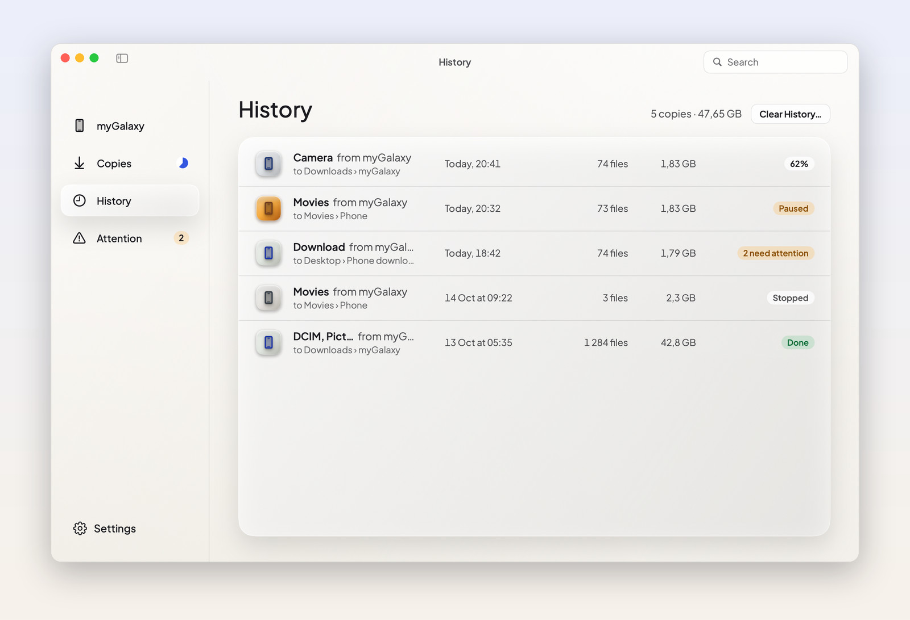

<h1 align="center">Pulli</h1>

<p align="center">
  <b>Copy photos and files from your Android phone to your Mac — and never lose progress.</b><br>
  A native macOS app. Plug in, pick what to copy, and Pulli does the rest, even if the cable
  comes out halfway.
</p>

<p align="center">
  <a href="https://github.com/ijahongirmirzo/pulli/releases/latest"></a>
  <br><sub>Free and open source · notarised by Apple · updates itself</sub>
</p>

<p align="center">or with <a href="https://brew.sh">Homebrew</a>:&nbsp; <code>brew install --cask ijahongirmirzo/tap/pulli</code></p>

<picture>
  <source media="(prefers-color-scheme: dark)" srcset="docs/images/hero-dark.jpg">
  
</picture>

## Why Pulli

Copying from an Android phone to a Mac has always been fragile: transfers that freeze, start over
from zero after a hiccup, or never find the phone because macOS grabbed it first. Pulli is built
around one promise: **a copy that has started will finish, with every byte checked.**

- **It never starts over.** Pull the cable, let the phone lock, close the lid, even force-quit
  Pulli: the copy pauses and later continues from the exact byte where it stopped.
- **It knows what is new.** One click copies only the photos you have not copied yet, and it
  skips anything already on your Mac, even under another name.
- **It just finds the phone.** No app to install on the phone. Pulli quietly frees the phone
  from macOS's own camera service and tells you, in plain words, what to tap if it is needed.

## What it does

<picture>
  <source media="(prefers-color-scheme: dark)" srcset="docs/images/copying-dark.jpg">
  
</picture>

**Copies you can trust.** Every file is written in checked blocks and finished only when it
matches what the phone sent. Pause, stop or carry on later; Pulli remembers.

<picture>
  <source media="(prefers-color-scheme: dark)" srcset="docs/images/resume-dark.jpg">
  
</picture>

**Unplugged? No problem.** Everything copied so far is safe. Plug the phone back in — into any
port — and Pulli continues by itself. Your Mac stays awake until it is done.

<picture>
  <source media="(prefers-color-scheme: dark)" srcset="docs/images/browse-dark.jpg">
  
</picture>

**Browse the phone like Finder.** List or icons, sorting, photo previews, Quick Look with Space,
drag and drop both ways, and ⌘C / ⌘V with Finder. Your phone also appears in Finder's sidebar,
under Locations.

<picture>
  <source media="(prefers-color-scheme: dark)" srcset="docs/images/done-dark.jpg">
  
</picture>

**Free up space safely.** After a copy, Pulli can delete the originals from the phone — but only
after checking each copy on your Mac against the phone, byte for byte.

<picture>
  <source media="(prefers-color-scheme: dark)" srcset="docs/images/storage-map-dark.jpg">
  
</picture>

**See what fills your phone.** A storage map shows where the space goes, and Pulli finds media
from WhatsApp, Telegram, Instagram and Viber.

<picture>
  <source media="(prefers-color-scheme: dark)" srcset="docs/images/menu-bar-and-widgets-dark.jpg">
  
</picture>

**Fits in on your Mac.** A menu bar item and desktop widgets show progress at a glance — and copy
new photos in one click. Close the window and Pulli keeps working from the menu bar. There are
notifications, Shortcuts actions, a plug-in chime and a cable check that tells you when a
better cable or port would copy faster.

<picture>
  <source media="(prefers-color-scheme: dark)" srcset="docs/images/history-dark.jpg">
  
</picture>

**History, on your terms.** Every copy is listed with what went where. Clear History forgets it
all — copies, the activity log and saved previews — whenever you like.

## Get started

1. [Download Pulli](https://github.com/ijahongirmirzo/pulli/releases/latest), open the
   disk image and drag Pulli to Applications. Or install it with [Homebrew](https://brew.sh):

   ```bash
   brew install --cask ijahongirmirzo/tap/pulli
   ```
2. Plug your phone into the Mac with a USB cable that carries data, and unlock the phone.
3. On the phone, tap the USB notification and choose **File transfer**. Tap **Allow** if it asks.

Pulli finds the phone within a few seconds and shows what is on it. Pulli updates itself (you
can turn automatic checks off in Settings); with Homebrew, `brew upgrade` works too.

**Which Macs:** every Mac with Apple silicon — an M1 chip or newer — running macOS 26 Tahoe or
later. That is every MacBook Air, MacBook Pro, Mac mini, iMac, Mac Studio and Mac Pro with Apple
silicon, from late 2020 on. Intel Macs are not supported. To check yours: Apple menu › About This
Mac shows "Chip: Apple M…".

**Which phones:** any Android phone with a USB cable that carries data and offers "File transfer".
Tested with Samsung Galaxy and Lenovo phones.

## Privacy

Pulli works entirely on your Mac. No account, no analytics, nothing sent anywhere.

- Your files go straight from the phone to the folder you choose.
- The only time Pulli goes online is to check for updates (you can turn this off), and when you
  choose **Send Feedback**, which opens an email you can read before sending.
- Clear History removes Pulli's record of what you copied.

## Questions

<details>
<summary><b>Pulli does not see my phone</b></summary>

- Unlock the phone and choose **File transfer** in its USB notification (not "Charging only").
- Try another cable: many cables only charge. Pulli's "Phone not showing up?" link walks you
  through it.
- Quit other apps that talk to phones (Android File Transfer, OpenMTP, Smart Switch, Image
  Capture). Pulli frees the phone from macOS's own camera service by itself.
</details>

<details>
<summary><b>The phone does not appear in Finder's sidebar</b></summary>

macOS asks you to allow it once: System Settings › General › Login Items & Extensions › File
Providers › turn on Pulli. Pulli shows a short animated guide the first time.
</details>

<details>
<summary><b>What happens if the copy is interrupted?</b></summary>

Nothing is lost. Pulli saves its progress as it goes, so after a pulled cable, a locked phone, a
sleeping Mac or a crash it continues from the last byte that was safely written — it never starts
a file again from the beginning unless the file on the phone has changed.
</details>

<details>
<summary><b>Why is copying slow?</b></summary>

Many phones connect over USB 2 (about 30 MB/s). Pulli measures your cable and tells you when a USB
3 cable or another port would be faster, and by how much.
</details>

## Build from source

```bash
Vendor/build-deps.sh      # build libusb and libmtp from pinned sources
swift build               # build everything
scripts/make-app.sh       # build/Pulli.app
```

See [docs/DEVELOPMENT.md](docs/DEVELOPMENT.md) for the developer tools, the command-line tool,
tests, signing and releases, and [docs/DECISIONS.md](docs/DECISIONS.md) for why each part
exists. Pulli's Finder integration is available on its own as the
[FinderLocations](Packages/FinderLocations) Swift package.

## Contributing

Bug reports and ideas are welcome. The most helpful report includes your phone model and Pulli's
activity log (Window › Activity Log). See [CONTRIBUTING.md](CONTRIBUTING.md).

## Licence

Pulli is free software under the [GNU General Public License v3](LICENSE) or later, with an
additional term that versions of Pulli keep the credit "Pulli, created by Jakhongirmirzo
Ibrokhimov" (see [NOTICE](NOTICE)). The [FinderLocations](Packages/FinderLocations) package is
under the Apache License 2.0. Third-party code keeps its own licence:
[THIRD_PARTY_NOTICES.md](THIRD_PARTY_NOTICES.md).

The name Pulli and its logo are not covered by the licence.

Created by Jakhongirmirzo Ibrokhimov.
